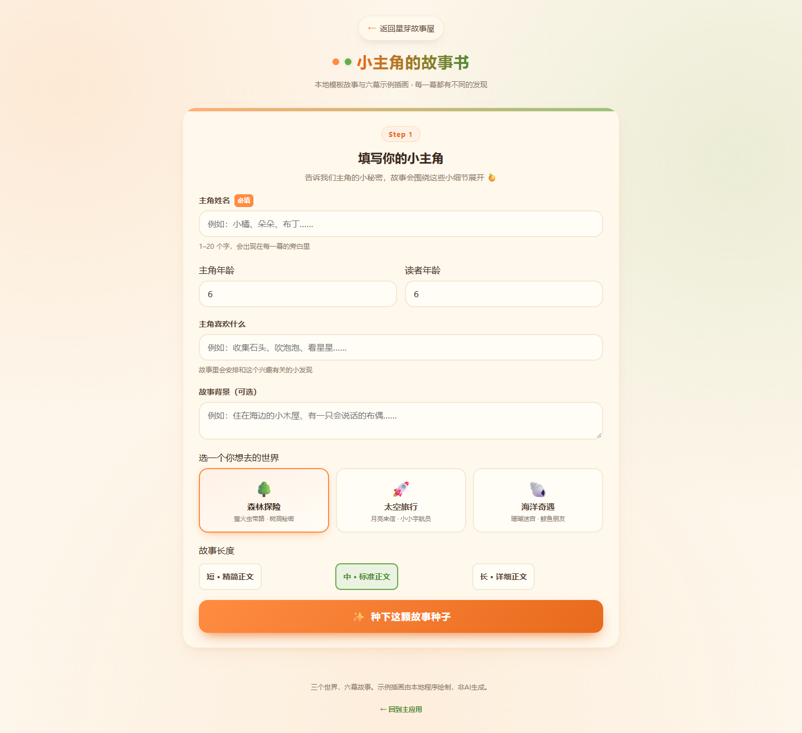

# 星芽故事屋 · 个性化儿童故事创作

AIGC创新应用实践课程项目。围绕个性化儿童故事，提供结构化写作、绘本配图、多角色朗读、视频合成、素材检索及Agent工作流。

## 快速启动

推荐Windows + Python3.12。将整个仓库克隆或解压到D盘，双击根目录`启动故事屋.cmd`，保持终端窗口打开。

- 第一周故事网页：http://127.0.0.1:8766/trae-story.html
- 完整应用：http://127.0.0.1:8766
- [第一周使用说明](使用说明.md)
- [完整工程复现与CLIP准备](docs/reproduce.md)

首次启动按需安装requirements.txt中的依赖，虚拟环境和缓存保存在项目目录。第一周页面使用本地模板和预设插画，不需要API密钥。真实模型创作需另行配置本机.env；密钥与模型权重不进入仓库。

## 功能

|模块|功能|
|---|---|
|个性化网页|姓名、主角年龄、读者年龄、兴趣、背景与长度设置；森林、太空、海洋三主题；逐幕翻页|
|结构化故事|Python模型接口、JSON校验与格式修复、零样本/少样本/角色扮演对比|
|绘本|逐幕API配图、固定角色描述与Seed、PDF排版|
|有声书|三位故事角色与旁白使用4种音色，情绪韵律参数，同步文字高亮|
|故事视频|图片、配音、背景音乐及字幕自动合成为MP4|
|素材检索|12模板、24张素材图、6音效；文本TF-IDF与图像ONNX CLIP|
|Agent|LangChain工具注册、模型规划、暂停干预与四项核心工具执行|



## 作品与报告

|内容|入口|
|---|---|
|前八周逐项交付|[交付索引](docs/course-submission.md)|
|两套完整图文音视频案例|[作品目录](outputs/README.md)|
|系统架构与数据流|[架构说明](docs/architecture.md)|
|三种Prompt策略对比|[对比报告](docs/prompt-quality-analysis.md)|
|角色一致性方案|[方案与对比图](docs/character-consistency.md)|
|多角色配音|[音色及参数表](docs/voice-design.md)|
|视频制作|[剪辑流程](docs/audio-video-pipeline.md)|
|素材检索|[构建与评估](docs/week06_retrieval_evaluation.md)|
|Agent工作流|[架构与案例](docs/week07_agent_architecture.md)|
|协作记录|[AI协作日志](ai_log.md)|
|现场展示|[操作检查与答辩指南](docs/student-confirmation.md)|

## 项目结构

```text
src/storybook/        Python服务、生成、媒体、检索与Agent
web/                  完整应用及第一周独立页面
scripts/              启动、素材准备、样本恢复与校验
data/library/         本地可复用素材
docs/                 报告、方案、运行验证与协作日志
outputs/final-cases/  森林、海洋两套终版作品与流程记录
outputs/prompt-comparison/ 三策略真实输出
tests/                工程测试
ai_log.md             协作日志索引
requirements.txt      依赖版本
```

## 验证与使用边界

`python scripts/verify_submission.py`离线校验两套案例的55个清单文件和故事绑定；运行检查记录见`docs/submission-verification.json`与`docs/restored-cases-http-check.json`。

模板模式与真实模型模式分别标注。第一周18幅SVG和素材库程序图不作为文生图API产物；最终API作品见作品目录。CLIP缺失时会明确降级，需按复现说明准备模型。视频与音频为预生成案例，可本机直接播放。

第一周117.87秒操作录屏独立作为附件提交。课程平台提交与第八周现场展示状态见交付索引。
