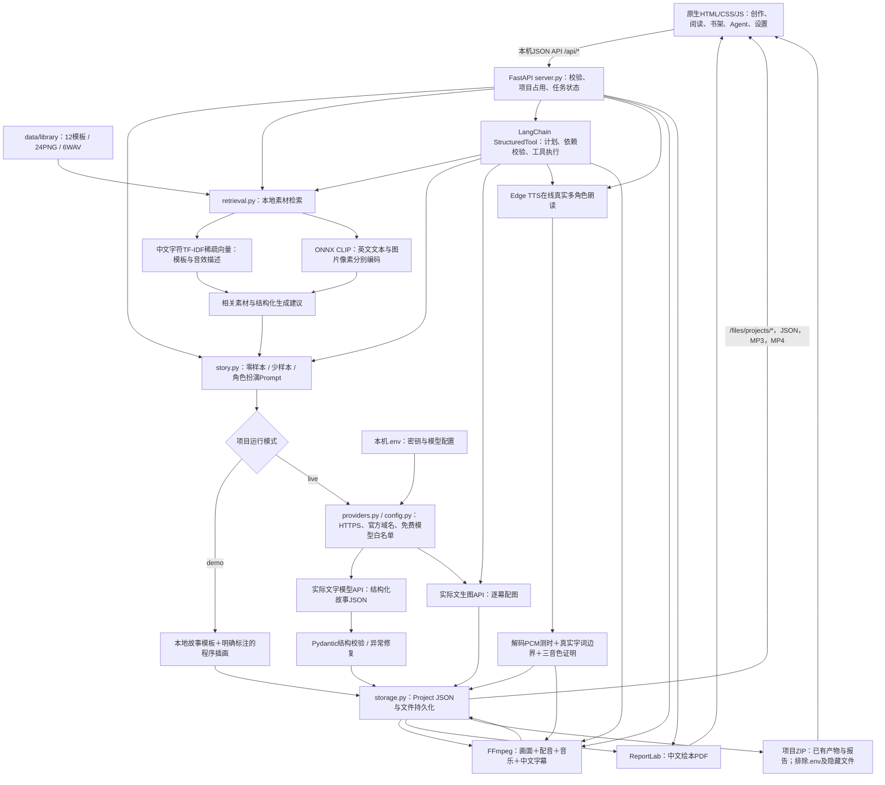
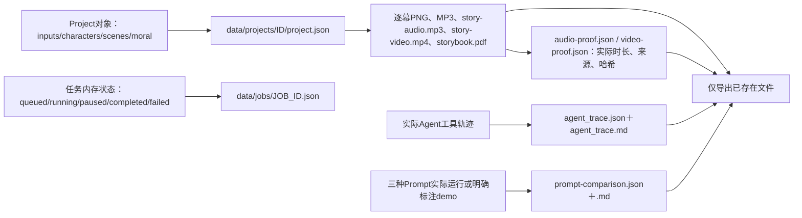

> 提交整理于2026-10-29。本文保留实际实验时间和局限；当前终版与提交状态以 [前八周交付索引](course-submission.md) 为准，历史实验与终版分别标注。

# 系统架构与技术边界

本应用由本机浏览器界面与Python服务组成。浏览器只访问本机FastAPI，不直接携带密钥请求外部模型。启动绑定`127.0.0.1`；真实模型、在线TTS和首次模型下载需要网络。依赖版本以根目录`requirements.txt`为准，启动环境建议Python 3.12。

## 一次创作的数据流

文字Prompt模板在`src/storybook/story.py:prompt_messages`；三种策略通过不同系统指令/格式示例构建相同字段协议。`providers.py`使用Python HTTP客户端调用实际模型接口，处理限流/服务异常重试、缓存、JSON围栏或外部说明文本、根对象和故事字段校验。缓存和模拟测试不能代替真实API调用证据。

用户在Agent工作台输入干预后，服务在工具边界调用`revise_story`更新故事，再规划和重做衍生媒体。核心工具为写作、绘图、TTS、视频；模型可选择增加素材检索、故事结构审查和重试，程序校验依赖与步数上限。demo采用公开四步规则；live才注入真实模型规划器。当前`review_story`检查结构、角色与场景，不宣称完成了模型语义质量审稿。

## 文件与状态流

`project.json`使用临时文件替换保存。服务对同一项目的制作任务及修改操作控制占用，避免旧状态覆盖新产物；失败任务保留错误状态，不把失败伪装为成功。重新修订文字后，应重新生成图片、音频与视频；只有文件、证明记录与成功状态一致，才计为完成。进度条不是产物质量或课程通过的证明。

`data/projects/`是应用运行目录；老师要求的提交`outputs/`目录由本人整理选定成果。`.env`只留本机，Git忽略且不进入作品ZIP；自行复制整个项目交作业时仍需排除该文件、缓存和虚拟环境。

## 检索与模型的准确说明

- **TF-IDF是语料统计特征，不是神经网络训练嵌入。** 本项目在素材描述上拟合中文字符1—3元组词表和IDF，形成L2归一化稀疏向量，以余弦相似度检索。这是真实文本向量检索，但没有训练文本语义模型，也没有使用Chroma或FAISS。音效按文字描述检索，未做音频内容嵌入。实现依据[TfidfVectorizer官方文档](https://scikit-learn.org/stable/modules/generated/sklearn.feature_extraction.text.TfidfVectorizer.html)。
- **图片CLIP是真实模型推理。** 使用[Xenova的CLIP ONNX导出](https://huggingface.co/Xenova/clip-vit-base-patch32)，基于[OpenAI CLIP ViT-B/32模型](https://huggingface.co/openai/clip-vit-base-patch32)；本项目固定revision并以CPU量化编码器提取512维图文向量，没有进行模型训练或微调。来源、哈希与实际加载验证见`data/models/clip/download_manifest.json`。
- **中文支持有明确范围。** 英文CLIP文本编码器前加入公开的有限中文主题词典，不是通用机器翻译。API返回转换后的英文和未覆盖中文；模型/依赖缺失或加载失败时明确显示标签文本降级，不冒充CLIP。评估见`week06_retrieval_evaluation.md`，三个查询不能支持开放域性能结论。
- **故事与插画来源分开。** demo文本为本地模板，示例图由Pillow程序绘制；live才调用实际文字和图片模型。当前白名单是项目保护配置，不代表平台对所有账号永久免费；可用性、配额与价格以[供应商官方模型文档](https://docs.bigmodel.cn/cn/guide/start/model-overview)为准。

## 框架与实现来源

| 组件 | 本项目职责 | 官方或维护者来源 |
|---|---|---|
| FastAPI / Pydantic | 本机HTTP接口、请求和故事结构校验 | [FastAPI](https://fastapi.tiangolo.com/)、[Pydantic](https://docs.pydantic.dev/latest/) |
| LangChain-core StructuredTool | 注册并实际执行受限工具，记录规划来源 | [StructuredTool参考](https://reference.langchain.com/python/langchain-core/tools/structured/StructuredTool/) |
| scikit-learn | TF-IDF稀疏文本特征与余弦检索 | [TfidfVectorizer](https://scikit-learn.org/stable/modules/generated/sklearn.feature_extraction.text.TfidfVectorizer.html) |
| ONNX Runtime / tokenizers | CPU图文模型推理、英文CLIP分词 | [ONNX Runtime](https://onnxruntime.ai/docs/)、[Hugging Face Tokenizers](https://huggingface.co/docs/tokenizers/) |
| Edge TTS | 使用在线语音服务返回实际语音及字词边界 | [edge-tts维护者仓库](https://github.com/rany2/edge-tts) |
| FFmpeg / imageio-ffmpeg | 音频解码、音画与字幕滤镜、MP4编码 | [FFmpeg文档](https://ffmpeg.org/ffmpeg.html)、[imageio-ffmpeg](https://github.com/imageio/imageio-ffmpeg) |
| Pillow / ReportLab | 程序插画、中文字幕卡与绘本PDF | [Pillow](https://pillow.readthedocs.io/)、[ReportLab](https://docs.reportlab.com/) |

与代码版本一致的依赖声明保存在`requirements.txt`。测试采用临时目录、MockTransport与内存回调核查失败边界和执行逻辑；只有实际外部服务请求、可解码媒体与真实轨迹能证明完整案例已经运行。

## 免费模型的职责分配

故事创作使用本机选择的免费文字模型；Agent规划和自然语言修订使用白名单内的`glm-4-flash-250414`，降低免费GLM-4.7-Flash拥堵对短流程请求的影响。每次响应按实际model记录，不把不同模型的结果说成同一模型。图片仍使用`cogview-3-flash`。429限流按8秒、20秒进行有界退避，失败保留真实错误。

## 文本与媒体的一致性

API原始响应按请求哈希另存。显示正文从全部对白同步，避免遗漏剧情；旁白中带明确姓名标记的引语可确定性分配给角色。过长输出只抽取原始完整句子并记录字数，仍需核查衔接。故事修订后保留原始结果，并重新生成派生媒体；详细过程见对应修订记录。
