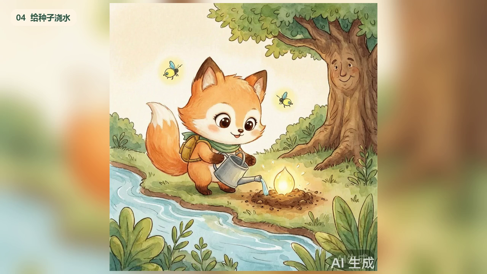
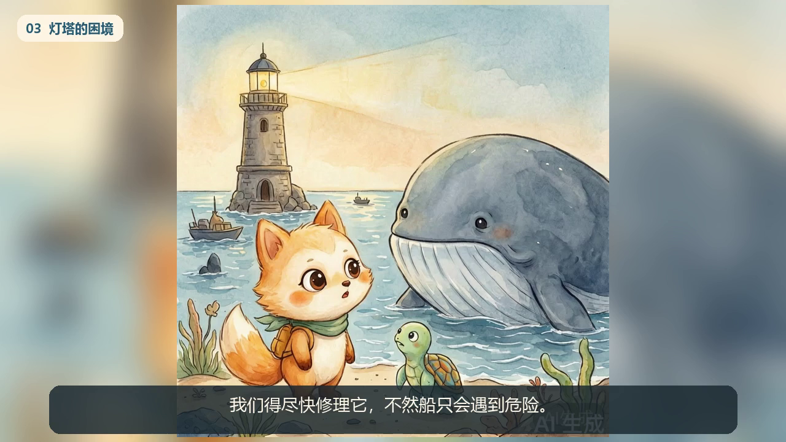

# 第四、五周：配音与自动剪辑流程

选用代码剪辑路线，使用FFmpeg合成，不要求视频生成模型。输入是同一份project.json、六幕API图片、真实Edge TTS配音和本地背景音乐。

1. 根据角色映射为三位故事人物及独立旁白选择4种固定音色。逐句情绪调整语速/音调/音量，参数保存于audio-proof.json，见[参数表](voice-design.md)。
2. 在线TTS返回实际MP3和WordBoundary；解码测量时长并建立统一时间轴。配音失败明确报错，不用静音凑足三分钟。
3. 拼接故事音频，网页按同一时间轴高亮；图片与字幕按相应段落显示。
4. FFmpeg合成1280×720、24fps MP4，加入BGM及中文字幕。正文变化会使相关缓存失效；复用缓存如实标注，不当作再次在线调用。
5. 输出story-audio.mp3、story-video.mp4、storybook.pdf及证明文件。实现见src/storybook/media.py，字幕导出脚本见scripts/export_subtitles.py。

|终版|音频|视频|音色|字幕|
|---|---|---|---|---|
|森林|414.264秒|约414.26秒|4种|108条|
|海洋|419.04秒|419.04秒|4种|107条|

历史实际检查包含音频解码、抽帧、电平、字幕文本与时间轴；抽样不代替本人完整试听和观看。两本成片及证明见[作品目录](../outputs/README.md)。情绪为韵律模拟，不保证具有服务原生情感风格的效果。

