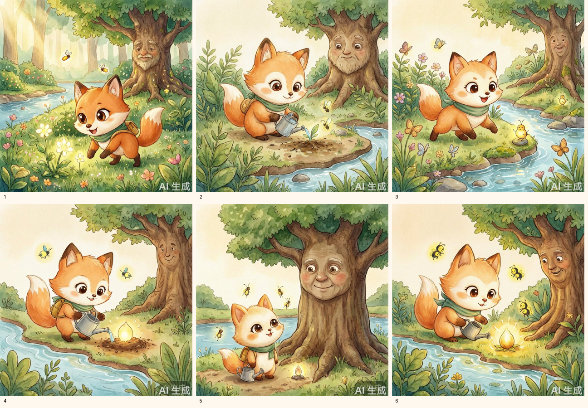
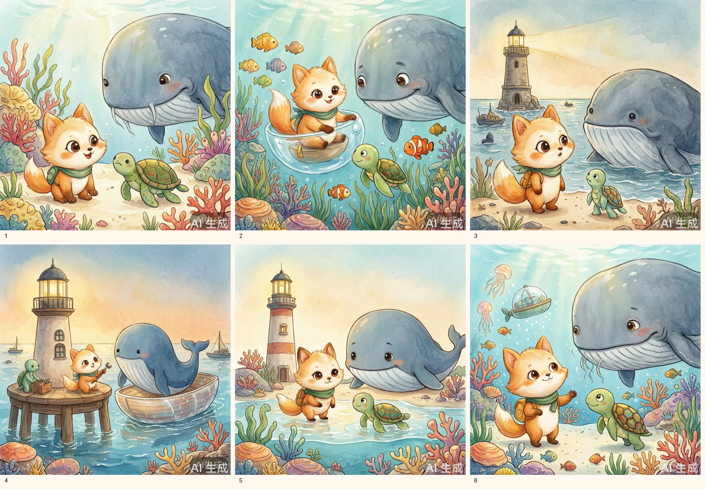

# 第三周：角色一致性方案与效果

采用方案一：固定详细外貌描述+固定Seed20261027。最终两套案例均使用wan2.7-image-pro，每个场景实际调用并保存一张API图片；另向接口发送同一狐狸参考图，不将其称为IP-Adapter或LoRA。

固定识别点：暖橘色幼年狐狸、奶油白脸颊与尾尖、大棕眼、青绿色围巾、金黄色小背包。逐图提示词、Seed、参考图哈希、模型及图片哈希位于各案例scene-XX.proof.json。

结果观察：主要身份特征基本可辨，环境和动作随剧情变化；伙伴的纹理、体态、比例与道具仍可能变化，不能宣称逐像素一致。固定Seed并不单独保证所有画面细节相同，仍需逐图检查。之前的重复狐狸与配角漂移在终版修订中处理，当前image-review.json保留复核信息。

两本PDF各8页、各6幕配图，见[最终作品](../outputs/README.md)。第一周18幅SVG及素材库24张程序图不是本次真实文生图API成果。
