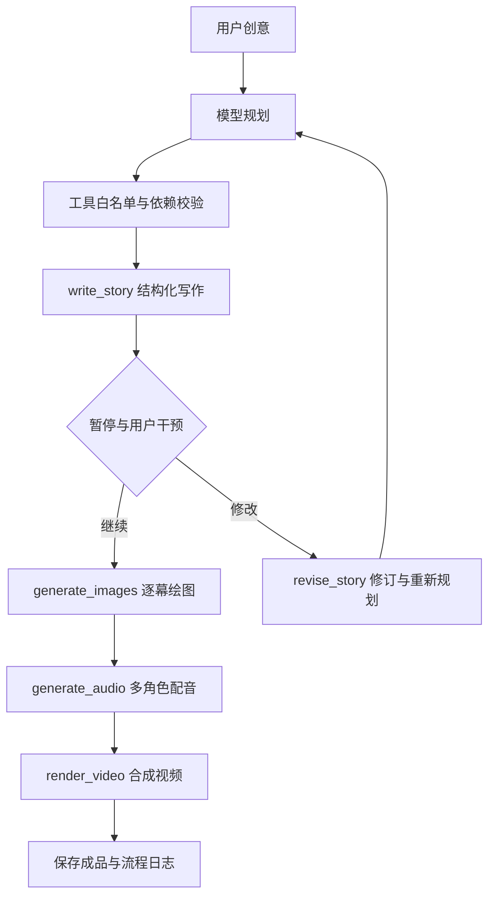

# 第七周：交互式多模态故事Agent

## 架构

`src/storybook/agent.py`使用LangChain-core的StructuredTool注册并通过ainvoke执行工具。四个核心工具是写作、绘图、配音、视频；可选素材检索和故事结构审查。程序限制步数、工具白名单及依赖顺序；demo采用固定四步规则，live使用模型规划。

## 中途干预

故事完成后可暂停。森林案例接收“保留主角‘小栗’，让故事结尾更突出朋友之间的合作。”，实际修订最后一幕，前五幕正文保留，再生成相关媒体。第一次运行失败后的重试明确记录同一指令重放。查看案例内human-intervention.json、human-intervention-retry.json、before-human-intervention.json和revision-record.json。

## 两个完整案例

|案例|输入|输出与轨迹|
|---|---|---|
|会发光的种子|[创意与参数](../outputs/final-cases/forest-final-20261028/case-input.json)|[流程](../outputs/final-cases/forest-final-20261028/agent_trace.md)、[成品](../outputs/README.md)|
|小橘的珊瑚湾奇遇|[创意与参数](../outputs/final-cases/ocean-final-20261028/case-input.json)|[流程](../outputs/final-cases/ocean-final-20261028/agent_trace.md)、[成品](../outputs/README.md)|

两个案例均含四项核心工具的完成事件、模型规划轨迹、逐图来源、音视频时长证明及最终哈希清单。最终故事与55个清单文件可用scripts/verify_submission.py离线验证。缓存按实际输入和文件哈希校验，命中缓存与新模型请求分别记录。日志回放是既有创作记录，不是现场重新执行API。
