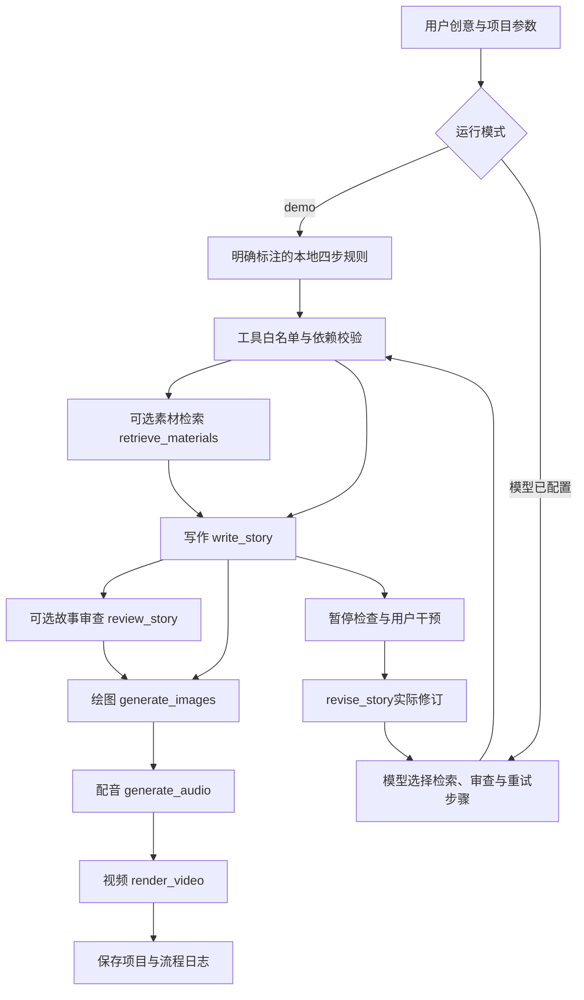

> 提交整理于2026-10-29。本文保留实际实验时间和局限；当前终版与提交状态以 [前八周交付索引](course-submission.md) 为准，旧样例不冒充终版。

# 第7周：交互式多模态Agent架构与验证

## 工具执行架构

`src/storybook/agent.py`通过真实 `langchain_core.tools.StructuredTool.from_function` 注册并使用 `ainvoke` 执行工具，不自行调用任何模型供应商，也不把固定规则称为模型自主规划。生成函数与已授权模型规划器由应用服务注入，便于限制模型名单、费用和配置密钥。

四项核心工具为 `write_story`、`generate_images`、`generate_audio`、`render_video`。模型可选择插入 `retrieve_materials`、`review_story`；可以重复工具作为重试，也可以选择最短四步分支。模型规划接口保持 `planner(instruction, project) -> list[str]`，默认demo仅使用四个核心工具。

规划须包含全部四种核心工具，最多20步。绘图依赖故事，配音依赖写作与绘图，视频依赖写作、绘图与配音；重写或用户实际修订后，必须重新生成衍生媒体，避免旧图、旧音频与新故事混用。未知工具、缺少核心工具、依赖颠倒或调用未注册可选工具都会在生成前被拒绝。review_story为只读结构检查，不清空已完成媒体。模型能够选择分支与审查位置，但安全约束和工具依赖由程序明确限制。

## 中途干预与日志

作业状态包含 `queued/running/paused/completed/failed`。启用 `pause_after_story` 后，故事完成即暂停；用户可提交自然语言修改并恢复。等待使用0.15秒异步轮询，不阻塞整个服务。指令在工具边界处理，通过 `revise_story(instruction)` 改变Project，再向规划器请求新计划。已生成的衍生媒体随后重做；demo重新执行其公开固定规则。

每个步骤记录时间、事件、工具名、规划模式及用户指令。返回值中的 `trace` 由应用保存为项目目录的 `agent_trace.json` 与Markdown流程说明；`job.logs`和`job.steps`供前端实时显示。记录中的 `planning_mode=demo_rules` 与 `planning_mode=model`用于区分两种执行来源。

## 实际验证证据与当前边界

测试文件为 `tests/test_retrieval_agent.py`，包含13项检索/Agent测试。2026-10-25主进程运行 `pytest tests/test_retrieval_agent.py tests/test_media.py`，取得 **`19 passed in 7.65s`**；全部13项检索/Agent测试及6项媒体测试均已实际通过。其中包含非法工具、依赖顺序、核心流程完整性及允许可选检索/审查/重试的校验。

文件另有6项异步测试：真实StructuredTool执行四工具、非法模型规划在生成前停止、暂停后用户修改影响后续产物、绘图后干预导致重新绘图、启动前排队指令仍执行初始写作、模型选择可选工具及重试。这些测试使用内存回调验证执行逻辑，不访问付费或真实生成服务；它们不能替代两个真实完整创作案例。

首次子代理测试环境缺少创建本地socket的权限，Windows asyncio在建立事件循环的 `socketpair` 处被阻塞；经faulthandler定位，尚未进入Agent函数。随后由获准创建本地socket的主进程执行完整测试，6项异步测试全部通过。此权限问题与Agent逻辑无关；应用本地运行不应沿用受限的测试沙箱。

2026-10-27已完成森林9b85bce9bd7147cb与海洋a2b46926a3b34ea7两个真实模型规划案例。各保留输入、故事JSON、6张API图、三音色音频、字幕视频及agent_trace.json/.md。成功任务分别为461e5b8468e54208和e9dbbcea95bf4055。

森林实际暂停后接受“把主角名字改成小芽。”并请求新模型计划。精确改名是确定性替换，不额外调用文本模型重写，也不是复杂情节理解能力的证明。此为AI助理技术验收，不冒充学生本人操作。

森林Agent完成后又经AI助理文字编辑并重制媒体，归属见editorial-record.json；最终495.024秒，编辑前结果在docs/evidence/live-agent-intervention/successful-run/after-agent-before-edit.json。海洋最终294.672秒。详见docs/validation-report.md。

## 2026-10-28当前修订

新终版见validation-report.md，两个最终任务编号以当前agent-final-manifest.json为准。森林真实暂停后收到用户“保留主角‘小栗’，让故事结尾更突出朋友之间的合作。”，后续失败重试保留来源。末幕模型局部修订，前五幕不变，三位人物分工；新图像审查要求参与图片Prompt。音频/视频缓存按实际内容及文件哈希验证且在工具日志明确披露，PDF排版重导出仍在render_video工具中执行；最终清单绑定全部实物与轨迹。
